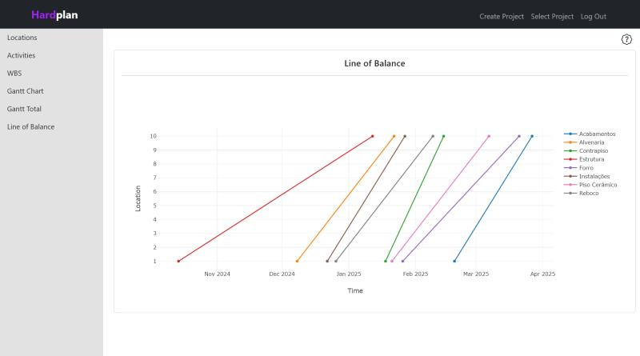

# Hardplan: Construction Project Management Tool



## Description

Hardplan is a web-based application for managing construction projects using scheduling algorithms such as the Critical Path Method (CPM) and Line of Balance (LOB). Built with Flask, Python, and SQLite3, it lets users create Gantt charts and Line of Balance visualizations for better project planning and control.

## Features

- **Project creation**: Define tasks and locations for a detailed project breakdown.
- **Task management**: Add durations and dependencies between tasks.
- **Scheduling algorithms**: Automatically calculate task start and end times using CPM and LOB.
- **Gantt charts**: Visualize project schedules by location or across all locations.
- **Line of Balance**: Analyze task progress across multiple locations.
- **Interactive visualizations**: Explore task relationships with Mermaid.js and schedule data with Plotly.js.

## Installation

1. Clone the repository:

```bash
git clone https://github.com/lucas-rollin/hardplan.git
```

2. Navigate to the project directory:

```bash
cd hardplan
```

3. Create and activate a virtual environment:

```bash
python3 -m venv venv
source venv/bin/activate    # On Windows: venv\Scripts\activate
```

4. Install dependencies:

```bash
pip install -r requirements.txt
```

5. Run the application:

```bash
flask run
```

## Usage

1. After starting the application, open `http://127.0.0.1:5000` in your browser.
2. Register for an account, or log in if you already have one.
3. Create a new project, add tasks and locations, and explore the schedule using the built-in Gantt and Line of Balance charts.

## Project Structure

```
hardplan/
├── static/             # Static files (CSS, JS, etc.)
├── templates/          # HTML templates
├── app.py              # Main application
├── helpers.py          # Utility functions and scheduling algorithms
├── database.db         # SQLite3 database
├── requirements.txt    # Dependencies
└── README.md           # Project README
```

### Routes Overview

| Route             | Description                                       |
|-------------------|---------------------------------------------------|
| `/index`          | Homepage                                          |
| `/login`          | Handles user login                                |
| `/register`       | Handles user registration                         |
| `/create-project` | Creates a new project                             |
| `/select-project` | Displays a list of the user's projects            |
| `/location`       | Adds and displays project locations               |
| `/task`           | Adds and displays project tasks, with a flowchart |
| `/gantt`          | Gantt chart for the typical floor                 |
| `/gantt-total`    | Gantt chart for all locations                     |
| `/lob`            | Line of Balance chart                             |

### SQL Tables Overview

| Table              | Description                                  |
|--------------------|----------------------------------------------|
| `users`            | Stores user credentials                      |
| `projects`         | Stores project details                       |
| `lbs`              | Stores project locations                     |
| `wbs`              | Stores project tasks and scheduling details  |
| `wbs_predecessors` | Handles multiple predecessors per task       |
| `wbs_lbs`          | Links tasks (WBS) to locations (LBS)         |

## helpers.py Functions

- **Database management**
  - `get_db()` and `close_db()`: Handle database connections.

- **Authentication and input requirements**
  - `login_required()` and `check_requirements()`: Ensure routes are protected by login and that the necessary project inputs exist.

- **Scheduling algorithms**
  - `calculate_date_cpm()`: Calculates CPM attributes for project tasks.
  - `calculate_lob()` and `calculate_lob_total()`: Apply LOB across multiple locations.
  - See the [detailed analysis](#scheduling-algorithms-analysis).

- **Data visualization**
  - `get_mermaid()`: Converts task data into a Mermaid.js flowchart.

## app.py Overview

- **index**: Homepage.
- **login and register**: Handle user login and registration.
- **create-project**: Takes a start date to create a project and trigger the scheduling algorithms.
- **select-project**: Displays a list of the user's projects.
- **location**: Manages project locations, allowing locations to be added and deleted.
- **task**: Manages task input (name, duration, predecessors) and generates flowcharts with Mermaid.js.
- **wbs**: Displays the full CPM results for the project.
- **gantt-data**: Provides task data for the Gantt chart (by location).
- **gantt-total-data**: Provides task and location data for the Gantt chart across all locations.
- **lob-data**: Provides data for the Line of Balance chart.

## HTML Templates Overview

- **layout and layout2**: Define the standard page layouts. `layout` includes a sidebar for core navigation; `layout2` is a simpler layout for pages like login and registration.
- **login, register, create-project, select-project**: Pages for user input and project creation.
- **location**: Displays and updates a table of project locations, allowing deletion of the most recent entry.
- **task**: Displays and updates a table of project tasks, including a task flowchart.
- **wbs**: Displays the full results from the CPM algorithm.
- **gantt and gantt-total**: Fetch data to render Gantt charts for a single location and for all locations, respectively, using Plotly.js.
- **lob**: Fetches data to render the Line of Balance chart using Plotly.js.

## Scheduling Algorithms Analysis

### Critical Path Method (CPM)

`calculate_date_cpm()` implements CPM to calculate task start and end dates. It performs a forward pass to compute each task's Earliest Start (ES) and Earliest Finish (EF), followed by a backward pass to compute the Latest Start (LS) and Latest Finish (LF).

**Design decisions:**
- **Iteration strategy**: A topological sort was initially considered for efficiency, but a simpler `while` loop was used instead, iterating over the tasks until all attributes are calculated.
- **Slack and critical tasks**: Once both passes are complete, slack (the difference between the latest and earliest start times) is computed. A task with zero slack is critical, meaning any delay to it delays the whole project.

### Line of Balance (LOB)

`calculate_lob()` handles task scheduling across multiple locations using two nested loops: one over tasks and one over locations. `calculate_lob_total()` performs a global calculation of task starts and finishes across all locations, rather than for each location individually.

**Design decisions:**
- **Task and location iteration**: The algorithm calculates the start and end of each task in each location. It compares task durations with those of their predecessors to decide whether to schedule forward or backward (i.e., from the first location to the last, or vice versa).

## About

Built as the capstone project for [CS50x](https://cs50.harvard.edu/x/), Harvard University's Introduction to the intellectual enterprises of computer science and the art of programming